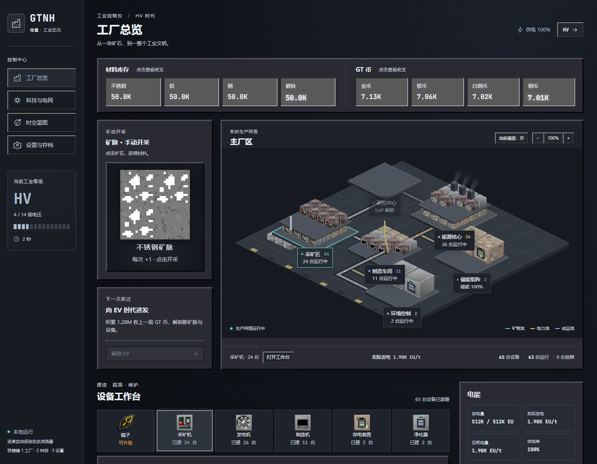

# GTNH 增量

本地私人使用的 GTNH 主题增量 / 放置游戏，从 ULV 开始发展到 MAX。
主画面是可交互的工业厂区，机器、输送线与电力反馈随真实进度变化。

- 项目现状、运行命令与产物：[docs/status.md](docs/status.md)
- 代码结构与界面约束：[docs/architecture.md](docs/architecture.md)
- 现行游戏规则：`plan.txt`
- 后续玩法与画面执行计划：[docs/redesign-plan.md](docs/redesign-plan.md)

首次使用执行 `npm install`，开发执行 `npm run dev`。
可运行 `npm run build` 生成便携游戏与常规 Web 目录；具体入口见操作说明。

